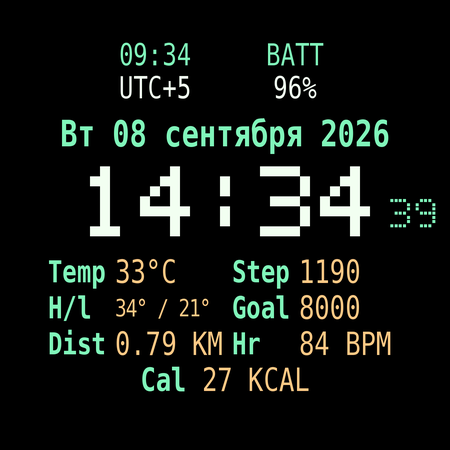

# Terminal Face — Wear OS API 34–37

Тестовая версия 0.7.0-test: настройки жирности и регистра даты/подписей,
русский, английский или системный язык даты. Шапка UTC/BATT не меняется.
Семь полей, увеличенная дата и три шрифта крупных часов сохранены.
Чёрный фон, зелёные подписи, янтарные значения,
пиксельные крупные часы и читаемый контурный моноширинный шрифт мелкого текста.
Основа для других циферблатов сохранена в первом коммите `931c71e` ветки `main`;
этот дизайн разрабатывается в `feat/terminal-face`.



Числа в дизайн-превью иллюстративные. В установленном циферблате время и дата
системные; UTC-время, местное UTC-смещение и батарея также берутся из системы.
Нижние показатели поступают от выбранных пользователем поставщиков
complications. Отсутствующие данные показываются как `--`.

## Настройка

Удерживать циферблат → редактирование. Семь независимых источников: три строки
слева, три справа и одно широкое поле снизу по центру. Каждый принимает `SHORT_TEXT`,
`LONG_TEXT`, `RANGED_VALUE`, `GOAL_PROGRESS` и `EMPTY`.

Новые настройки редактора:

- «Дата и подписи — начертание»: обычное или жирное.
- «Дата и подписи — регистр»: ВСЕ ПРОПИСНЫЕ, первая буква прописная,
  все строчные или как у источника.
- «Язык даты»: русский, английский или язык часов.

По умолчанию русский, жирный, первая прописная — как в последнем согласованном
превью. Время UTC, пояс, BATT, процент, AM/PM, секунды и сами показания остаются
прежними. Меняются только дата и текстовые подписи семи полей. Язык даты
не переводит заголовки сторонних поставщиков. [Превью вариантов](docs/style-comparison.png),
[описание и тест настроек](docs/TYPOGRAPHY.md).

В настройке «Шрифт часов» выбрать один из трёх моноширинных TTF:

- Блочный — крупные терминальные пиксели (по умолчанию).
- Точечный — пиксельная матрица.
- Контурный — гладкий моноширинный шрифт.

Варианты имеют миниатюры с образцом своего шрифта. Двоеточие и каждый символ
центрированы в одинаковых ячейках; центр HH:MM совпадает с центром экрана.
Секунды справа не сдвигают часы. Переключение не меняет источники, подписи,
палитру или дату. В ambient для всех вариантов используется точечный шрифт.
[Сравнение шрифтов](docs/font-comparison.png),
[новая компоновка и сценарий теста](docs/COMBINED-LAYOUT.md).
Старые A/B/C доступны в сохранённой версии 0.4.0-test; настройка разметки
в новом APK убрана. Начиная с 0.6.0-test нижняя строка сохраняет slotId=4 и прежний
нижний левый источник. Нижний правый slotId=8 и его настройка подписи удалены;
остальные идентификаторы сохранены. В редакторе новый нижний пункт называется
«Нижняя строка — источник данных» / «Нижняя строка — подпись».

- Для каждой ячейки выбирается поставщик данных через системный редактор.
- Для каждой подписи есть отдельная настройка: 28 ручных вариантов длиной
  до четырёх символов, AUTO и отсутствие подписи. Например HR/BPM — пульс,
  NTFY — уведомления, STEP — шаги, SPO2 — кислород, ALRM — будильник.
  Все варианты имеют текстовые миниатюры и понятные расшифровки в настройках.
  Полный список и ограничения: [docs/LABELS.md](docs/LABELS.md).
- По умолчанию выбран AUTO: заголовок `COMPLICATION.TITLE`, иначе монохромный
  значок поставщика. Если отсутствуют оба, показывается нейтральное `—`.
  Поставщик не обязан предоставлять заголовок; вручную можно выбрать короткую
  подпись. Длинные строки сокращаются, значения от поставщика не пересчитываются.
- Настройки редактора переведены на русский. При обновлении старые ручные подписи
  сохраняются: для автоматических нужно один раз выбрать AUTO в нужной строке.
  Прежние HI/LO, STEPS и EVENT теперь отображаются как H/L, STEP и EVNT;
  их идентификаторы сохранены, поэтому повторный выбор не нужен.
- Настраиваются палитра, показ секунд и строка даты: полная, короткая, ISO или скрытая.
- Шаги и пульс имеют системных поставщиков по умолчанию; остальные слоты изначально
  пустые. Для погоды, дистанции, калорий, цели и ветра нужно выбрать совместимых
  поставщиков, доступных на конкретных часах. Цель не вычисляется из шагов.
- Верхний левый блок: текущее время UTC в формате `09:34`, ниже местный
  часовой пояс как `UTC+5`, включая сезонное смещение. Время UTC всегда 24-часовое;
  крупные часы и местный пояс следуют системным настройкам часов. Это не геолокация:
  если система сама не сменила пояс, циферблат также не определит его по GPS.
- Верхний правый блок: BATT и текущий процент заряда встроенного источника
  `BATTERY_PERCENT`; это не complication и не занимает нижний слот.
- Шапка — две колонки по две строки, центрированные вокруг центра экрана.
  Далее дата над часами. Визуальные отступы вокруг крупных цифр увеличены
  примерно в 1.5 раза относительно A из 0.4.0-test; шаг нижних строк уменьшен
  с 48 до 36. Размер часов 100, подписей 30, коротких значений 32 в сетке 450×450.
  Дата — 36 вместо 28; увеличена также её область, поэтому SEPTEMBER помещается
  полностью. Нижняя строка шириной 286 центрирует подпись и значение вместе,
  с сохранением разных цветов. Её шрифт 32, для LONG_TEXT — 30.
  Для длинных значений размер адаптирован к ширине круга;
  очень длинные строки всё ещё сокращаются.
  Используется настоящий моноширинный TTF с латиницей и кириллицей;
  изображения с буквами используются только как миниатюры вариантов в редакторе.
- Формат времени следует системному выбору 12/24 часа, с AM/PM при необходимости.
  Дата использует системное ICU-форматирование выбранного языка; ISO остаётся
  числовым Gregorian yyyy-MM-dd. Шрифты содержат латиницу и кириллицу.
- В ambient остаются время, шапка и выбранная строка даты; секунды и таблица скрыты.

## Среда и сборка

Требуются JDK 17 или новее, SDK Platform 37.0, Build-Tools 36.0.0 и platform-tools.
На текущем компьютере установлен JDK 21 и необходимые SDK-пакеты. AGP 9.4.0 и
Gradle 9.6.0 зафиксированы в проекте. Для другой машины настроить путь `sdk.dir`
в локальном `local.properties` или переменную `ANDROID_HOME`.

```sh
sdkmanager --install "platforms;android-37.0" "build-tools;36.0.0" "platform-tools"
./gradlew --no-daemon :watchface:assembleDebug :watchface:bundleRelease :watchface:lintDebug
```

APK: `watchface/build/outputs/apk/debug/watchface-debug.apk`.
AAB: `watchface/build/outputs/bundle/release/watchface-release.aab`.
Debug APK подписан ключом разработки, но не содержит кода и не является debuggable.
Release AAB пока без настроенной production-подписи.

WFF-пакет ресурсный: `android:hasCode="false"`, Kotlin отключён, R8 удаляет
сгенерированные классы, shrinkResources выключен, чтобы сохранить WFF-ресурсы.

## Проверка

Официальные инструменты Google загружаются в игнорируемый каталог `.tools/`.
Скрипт установки проверяет зафиксированные SHA-256; если upstream заменит файлы
релиза, установка остановится для проверки и явного обновления версии.

```sh
sh tools/setup_validation.sh
sh tools/check.sh
```

XML воспроизводится генератором, затем шрифты, миниатюры и иллюстративные превью:

```sh
python3 tools/build_layout.py --output /tmp/terminal-combined.xml
# Сравнить и применить XML к watchface/src/main/res/raw/watchface.xml.
python3 tools/rebuild_assets.py
python3 tools/test_layout.py
```

Для этого скрипта нужны Pillow и fontTools только на компьютере разработки.
Они уже установлены в текущей среде; для другой машины версии указаны в
`tools/requirements-assets.txt`.
Локальный рендерер превью приближённый; итоговое расположение проверяется на Wear OS.
Terminal Mono — переименованное, суженное до 80% подмножество DejaVu Sans Mono;
все символы сохраняют равную ширину. Исходник включён в `tools/assets/`, лицензия
включена и в исходники, и в ресурсный APK (`res/raw/dejavu_license.txt`).
Terminal Clock Mono — отдельная производная с ячейками 0.6 em и центрированными
контурами, чтобы выбор гладкого шрифта не смещал часы относительно двоеточия.

Дополнительная интеграционная проверка (только на эмуляторе с установленным и
активным Terminal Face):

```sh
python3 tools/check_emulator_timezones.py --serial emulator-5556
```

Скрипт временно меняет системный часовой пояс эмулятора, сохраняет скриншоты
и восстанавливает исходный пояс. Реальные устройства он не изменяет.

## Основные файлы

Готовые версии сохраняются в `versions/`, исходники фиксируются отдельным
коммитом и тегом `vVERSION`. Архивы не перезаписываются. Порядок сохранения
и статус старых итераций: [versions/README.md](versions/README.md).

- `watchface/src/main/res/raw/watchface.xml` — декларативный циферблат WFF 2.
- `watchface/src/main/res/xml/watch_face_info.xml` — метаданные системного редактора.
- `watchface/src/main/res/font/` — пиксельные TTF, Terminal Mono и Terminal Clock Mono.
- `watchface/src/main/res/drawable/preview.png` — изображение для выбора циферблата.
- `docs/DEVELOPMENT.md` — дальнейшие этапы и ограничения прототипа.
- `tools/labels.json` — каталог ручных подписей и их кратких обозначений.
- `tools/build_layout.py` — текущий генератор согласованной разметки из снимка 0.3.0.
- `tools/typography.py` — WFF 2 варианты начертания, регистра и языка даты.
- `tools/build_layout_variants.py` — сохранённый генератор прежних A/B/C и общие компоненты.
- `docs/VALIDATION.md` — выполненные проверки.

Для нового самостоятельного циферблата использовать отдельный каталог/репозиторий,
сменить `applicationId`, `namespace`, название и ресурсы. Базовая совместимость
задаётся `minSdk=34`, `targetSdk=37`, WFF 2; работа на каждом API проверяется отдельно.
