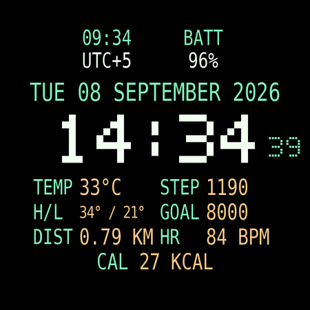

# Terminal Face для Wear OS

Два ресурсных циферблата из одного проекта: Compact с мелким шрифтом и семью
полями, Large с крупным шрифтом и пятью полями. API 34–37, Watch Face Format 2.
Оба устанавливаются одновременно и имеют независимые настройки.

| Приложение | Исходное оформление | Поля | Идентификатор |
|---|---|---|---|
| Terminal Face Compact | 0.8.1 | 7 | `dev.int0x19.watchface.terminal.compact` |
| Terminal Face Large | 0.9.1 | 5 | `dev.int0x19.watchface.terminal.large` |

[APK Compact](versions/0.8.1-compact/terminal-face-0.8.1-compact.apk) ·
[APK Large](versions/0.9.1-large/terminal-face-0.9.1-large.apk)

Новые пакеты не заменяют прежний `dev.int0x19.watchface.terminal`.
Источники дополнений и оформление нужно выбрать заново для каждого приложения.
Старые приложения автоматически не удаляются. Совместная установка на физических
часах ещё не проверена; разные идентификаторы подтверждены в собранных APK.

## Оформление

Compact сохраняет точный WFF и превью 0.8.1; Large — точный WFF 0.9.1.
Поменялись идентификаторы и названия приложений, не геометрия циферблатов.




Значения на превью иллюстративные. На часах время, дата, UTC-смещение и батарея
системные; нижние показатели поступают от выбранных поставщиков complications.

Общее у обеих версий:

- Десять [терминальных тем](docs/COLOR-THEMES.md) и независимый чёрный AMOLED-фон.
- Три моноширинных шрифта часов: блочный, точечный и контурный.
- Полная, короткая, ISO или скрытая дата; дата пока на английском.
- Системный формат 12/24 часа, отдельные секунды, UTC-время и местное смещение.
- Все поля настраиваются через системный редактор. Типы: SHORT_TEXT, LONG_TEXT,
  RANGED_VALUE, GOAL_PROGRESS, EMPTY. Нет встроенной загрузки погоды или расчёта целей.
- Подписи AUTO: заголовок поставщика, иначе монохромный значок, иначе `—`.
  Ручные списки подписей не возвращались, чтобы сохранить быстрый редактор.
- В ambient/AOD фон чёрный; таблица и секунды скрыты.

У Compact сверху UTC-время, ниже смещение; у Large — наоборот. В Large
подписи 34, дата и основные значения 40, длинные значения 38; часы 106.
Подробности: [разметка Large](docs/TYPOGRAPHY-HIERARCHY.md).

## Сборка обоих приложений

Нужны JDK 21, Android SDK Platform 37.0, Build-Tools 36.0.0, platform-tools,
Python с Pillow/fontTools. Node.js нужен для тестов интерактивных эскизов.
Gradle 9.6.0 и AGP 9.4.0 зафиксированы. Путь SDK задаётся через ANDROID_HOME
или игнорируемый `local.properties` с `sdk.dir`.

```sh
python3 -m venv .venv
. .venv/bin/activate
python -m pip install -r tools/requirements-assets.txt
sdkmanager --install 'platforms;android-37.0' 'build-tools;36.0.0' 'platform-tools'
sh tools/setup_validation.sh
sh tools/check.sh
```

Последняя команда проверяет обе разметки, собирает два APK и два AAB,
запускает lint, проверку подписей/пакетов, отсутствие DEX и Memory Footprint.
Официальные инструменты Google загружаются в игнорируемую `.tools/`
и проверяются по SHA-256. Замена upstream-файлов требует явного пересмотра сумм.

APK находятся в:

- `watchface/build/outputs/apk/compact/debug/watchface-compact-debug.apk`
- `watchface/build/outputs/apk/large/debug/watchface-large-debug.apk`

AAB находятся в `watchface/build/outputs/bundle/compactRelease/` и
`watchface/build/outputs/bundle/largeRelease/`. APK подписаны ключом разработки;
release AAB пока без production-подписи. Сборки не являются debuggable и не содержат DEX.

Метаданные обоих вариантов: [watchface/variants.properties](watchface/variants.properties).
Раздельные ресурсы: `watchface/src/compact/` и `watchface/src/large/`;
общие шрифты, темы, манифест и настройки — в `watchface/src/main/`.
[Product flavors Android](https://developer.android.com/build/build-variants)
разделяют приложения без форков и дублирования всего проекта.

## Проверки и сохранение версий

```sh
python3 tools/test_large_type_sketches.py
python3 tools/test_familiar_refinement.py
python3 tools/test_typography_hierarchy.py
python3 tools/check_publication.py
python3 tools/archive_version.py
```

Архивирование по умолчанию сохраняет оба приложения. Для одного можно указать
`--flavor compact` или `--flavor large`. Существующие архивы не перезаписываются.
Все прежние [версии и исходники](versions/README.md) сохранены; отдельные теги
содержат прежние состояния проекта. [Результаты проверок](docs/VALIDATION.md).

Ресурсные тесты не заменяют проверку на часах. API 35–37, конкретные поставщики,
реальная скорость Wearable и расход батареи новых независимых пакетов
пока не подтверждены на физических устройствах.

## GitHub и лицензия

Добавлена [GitHub Actions сборка](.github/workflows/build.yml) обоих приложений.
Она имеет только права чтения репозитория и сохраняет APK/AAB как артефакты,
не создавая GitHub Releases и не публикуя приложения автоматически.
Настройка ключей и порядок первой загрузки: [PUBLISHING.md](PUBLISHING.md).
Проверки перед изменениями: [CONTRIBUTING.md](CONTRIBUTING.md).

Собственный код — [MIT](LICENSE). DejaVu и его производные имеют отдельную
[лицензию шрифта](tools/assets/LICENSE-DejaVu.txt), включённую в оба приложения.
Исключения, ссылки на палитры и пользовательские референсы перечислены в [NOTICE](NOTICE).
Ключи подписи, токены, `.env` и локальные пути SDK не должны попадать в Git.
