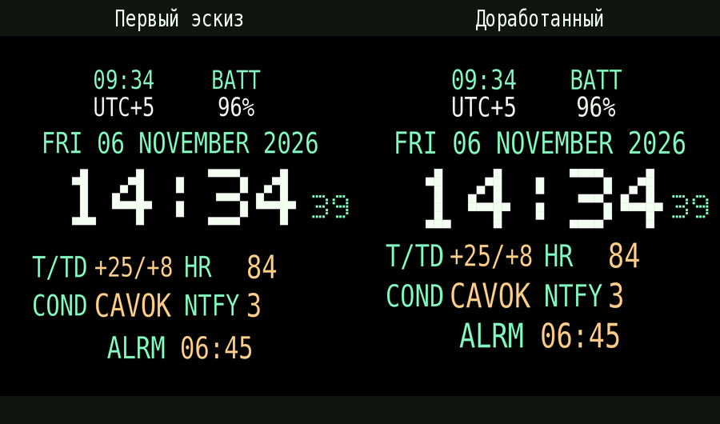

# Первый эскиз: равномерные интервалы и увеличенный текст

По подтверждению пользователя доработка перенесена в APK 0.9.0-large-type-test,
versionCode=12. Весь WFF совпадает с одобренным файлом эскиза побайтово;
иллюстративные показания в приложение не добавлялись. Снимки эскизов не менялись.
Тестовая сборка развивается в этой ветке, основная 0.8.1-test осталась в
`feat/terminal-face`. Подробные результаты: [VALIDATION.md](VALIDATION.md).

Ветка `feat/large-type-sketches`. Пользователь выбрал первый вариант с подписями
рядом со значениями. Второй и третий отклонены, но сохранены в первом снимке
`sketches/large-type-2026-11-06`. Пять независимых полей и общая нижняя строка
остаются; источники и AUTO-подписи не менялись.



## Изменения

| Элемент | Первый эскиз | Доработанный |
|---|---|---|
| Шапка UTC/BATT | 32 | 34 |
| Полная дата | 36 | 38 |
| Часы | 100 | 106 |
| Подписи в таблице | 36 | 38 |
| Короткие значения | До 40 | До 42 |
| Более длинный SHORT_TEXT | 34 | 36 |
| LONG_TEXT | 30 | 34 |
| Нижняя строка | 38 | 42 |

Размеры даны в единицах сетки 450×450. Для длинных показаний остаются адаптация
размера и многоточие; отображаемые данные не сокращаются или переписываются
самим эскизом до применения штатного многоточия. Ширина ячеек увеличена со 180
до 188, подписи — с 72 до 78, значения — со 102 до 108. Таким образом увеличение
шрифта не отнимает ширину у уже помещавшихся типовых показаний.

Три базовых положения строк теперь y=250, 300, 350 с одинаковым шагом 50.
Измерены также реальные границы светящихся штрихов, а не только области текста.
На одном и том же демонстрационном наборе с блочными часами видимые вертикальные
зазоры составили:

- От часов до первой строки: 36 → 16.
- Между двумя строками: 15 → 15.
- Перед общей нижней строкой: 22 → 16.

Данные у провайдера, строчные буквы, знаки с выносными элементами и выбранный
шрифт часов могут слегка менять видимый интервал. У точечных часов зазоры
17/15/16, у контурных 12/15/16. Для обоих вспомогательных шрифтов сохраняется
безопасный промежуток; идентичность визуальных границ разных шрифтов не заявляется.
Проверено, что полная дата с SEPTEMBER помещается и с новым размером 38.

## Сохранение и проверки

Новый снимок: `docs/large-type-sketches/2026-11-06-r2/`. В нём отдельный WFF XML,
три PNG с разными шрифтами часов, ambient, сравнение «до/после», интерактивный
просмотр и manifest.json с SHA-256 и измеренными интервалами. Первоначальные
три эскиза, рабочие ресурсы Android, APK/AAB и все прежние архивы не заменялись.
Управление в просмотре переключает только шрифт часов и сравнение первого
эскиза с доработанным, не возвращает отклонённые варианты.

```sh
python3 tools/refine_familiar_sketch.py
python3 tools/test_familiar_refinement.py
python3 tools/test_large_type_sketches.py
python3 tools/test_layout.py
python3 tools/test_archive.py
java -jar .tools/wff-validator.jar 2 docs/large-type-sketches/2026-11-06-r2/familiar-refined.xml
```

Шесть тестов доработки, шесть исходных эскизов, 22 текущей разметки и два архива
прошли. WFF 2 Validator принял новый XML. Проверены прежние настройки, политики
поставщиков, пять областей выбора без пересечений, целостность исходных снимков,
воспроизводимость PNG, реальные интервалы и отсутствие срезанных кругом штрихов
для обычных и длинных примеров с тремя шрифтами. Переключение сравнения/шрифта
проверено изолированно в Node.js, с Tweak и без него, не в полноценном браузере.

Изображения выше — предварительные рендеры, не скриншоты Wear OS. Для APK
используется именно эта разметка; отображение на часах ещё нужно проверить.
Названия оставшихся полей в редакторе обновлены до «Слева 1/2», «Справа 1/2»,
без изменения прежних slotId=2/3/4/6/7. Два удалённых поля (slotId=1/5) больше
не отображаются. При установке поверх 0.8.1 проверить сохранение выбранных
источников, палитры, фона и шрифта; при необходимости назначить источники заново.
