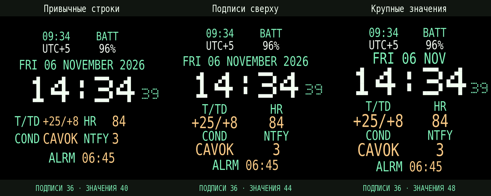

# Пять полей и крупный текст — предварительные эскизы

Дата: 2026-11-06. Отдельная ветка `feat/large-type-sketches` от `v0.8.1-test`
(`f938534`). Основная ветка циферблата `feat/terminal-face`, её APK и все
архивы остаются без изменений. Приложение в этой ветке пока тоже собирается
с прежним WFF 0.8.1-test: новые варианты находятся только в папке эскизов.

Удалена верхняя пара дополнений под часами: slotId=1 и slotId=5.
Осталось пять независимых настраиваемых полей: два слева, два справа и одно
широкое внизу по центру. Их прежние slotId=2,3,4,6,7 не перенумеровывались,
логика AUTO-подписей, типы данных и поставщики по умолчанию сохранены.
Примеры погоды, пульса, уведомлений и будильника иллюстративные, не фиксированные.
Фикстуры есть только в локальных превью, не в WFF.



## Варианты

Все размеры ниже — единицы сетки 450×450, не физические пункты на экране часов.

| Вариант | Компоновка | Подписи | Короткие значения | Часы | Дата |
|---|---|---|---|---|---|
| 0.8.1-test | Три пары строк и общее поле | 30 | 32 | 100 | Полная, 36 |
| Привычные строки | Две пары строк, подпись рядом со значением | 36 (+20%) | До 40 (+25%) | 100 | Полная, 36 |
| Подписи сверху | Сетка 2×2, подписи над значениями | 36 (+20%) | До 44 (+38%) | 100 | Полная, 36 |
| Крупные значения | Сетка 2×2, максимум места для чисел | 36 (+20%) | До 48 (+50%) | 108 (+8%) | Короткая, 42 |

Общая нижняя строка во всех трёх вариантах — 38 вместо 32 (+19%).
Шапка UTC/BATT: 32 в первых двух, 34 в третьем, вместо прежних 30.
У последнего варианта по умолчанию короткая дата без года, например FRI 06 NOV.
Полная дата как отдельный режим сохранена; для неё оставлен размер 36,
чтобы длинные названия месяцев помещались.

Это максимальные размеры для коротких показаний. В узких ячейках более длинный
SHORT_TEXT автоматически переходит на второй размер 34/38/42 соответственно;
LONG_TEXT — на 30/36/36. Очень длинные названия и значения сокращаются многоточием.
Подписи не заменяются вручную и могут быть длиннее четырёх символов, если так
их передаёт поставщик. «Привычные строки» сохраняют прежнее расположение,
но там ширина значения по-прежнему ограничена. «Подписи сверху» используют
всю ширину ячейки для значения и сохраняют полную дату — рекомендуемый баланс.

## Сохранение и воспроизведение

В `docs/large-type-sketches/2026-11-06/` сохранены три отдельных WFF XML,
девять PNG (каждая компоновка × три настоящих шрифта часов), три ambient-превью,
сравнение, самодостаточный интерактивный просмотр и manifest.json с SHA-256.
Старые PNG, ресурсы APK и версии не перезаписываются.

```sh
python3 tools/build_large_type_sketches.py
python3 tools/test_large_type_sketches.py
python3 tools/test_layout.py
python3 tools/test_archive.py
```

Для генерации используются прежние Pillow/fontTools и четыре сохранённых TTF.
Тест интерактивного просмотра дополнительно использует установленный Node.js;
в Android-пакет он не входит. Новые зависимости не устанавливались.

Проверки: шесть тестов эскизов, 22 прежних теста разметки и два теста архива — PASS.
Все три XML приняты официальным WFF 2 Validator. Проверены пять независимых
областей выбора без пересечений, центровка часов, сохранение настроек/поставщиков,
воспроизводимость PNG и целостность архивов. Для обычных и длинных примеров,
с каждым шрифтом часов, проверено отсутствие срезанных кругом штрихов текста.
Самодостаточный просмотр меньше 1 MB; переключение шрифта проверено, в том числе
без дополнительных средств управления. Полноценный браузерный проход не выполнялся.

Это приблизительный локальный рендер из WFF, не скриншоты Wear OS.
Реальное отображение и открытие редактора на часах ещё не проверены.
После выбора компоновки можно перенести её в ресурс приложения, обновить
видимые названия оставшихся строк без смены slotId и собрать отдельный APK.
