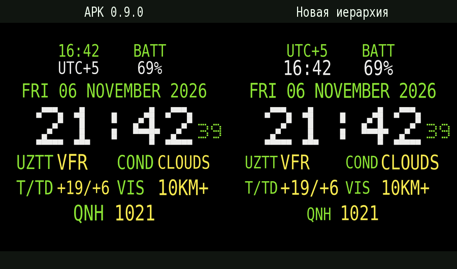

# Эскиз R3: подписи 34, значения 40

Основа: выпущенная 0.9.0-large-type-test в ветке `feat/large-type-sketches`.
Новый эскиз сохранён отдельно в `docs/large-type-sketches/2026-11-06-r3/`.
Android-ресурсы, APK/AAB, версии и прежние эскизы не менялись.



## Выбранные размеры и порядок

- Верхний левый блок: UTC+5 — 34, под ним время UTC — 40.
- Верхний правый блок: BATT — 34, под ним заряд — 40.
- Дата — 40, по-прежнему полная, с днём недели и годом.
- Подписи четырёх ячеек — 34, значения — 40; длинные показания — 38.
- Общее нижнее поле: подпись 34, значение 40, центрирование всей строки вместе.
- Крупные часы 106, секунды, пять настраиваемых источников, шаг строк 50,
  темы/AMOLED, три шрифта часов и остальные настройки сохранены.

Роли цветов тоже совпадают: UTC+5 и BATT используют цвет подписей;
UTC-время и процент заряда — цвет основного текста. Настройки палитр не менялись.

Уменьшенная ширина подписей 66 вместо 78 освобождает место значениям:
область значения 118 вместо 108. VFR, CLOUDS, +19/+6, 10KM+ помещаются
в размере 40; длинный SHORT_TEXT автоматически переходит на 38. LONG_TEXT
также использует 38 с немного уплотнёнными буквами. Очень длинные строки
по-прежнему сокращаются многоточием, не подменяя исходные показания.

Дата 40 использует letterSpacing=-0.02: строка WED 30 SEPTEMBER 2026 занимает
около 388.58 из доступных 390 единиц, то есть месяц не нужно сокращать.
Размеры даны в сетке 450×450, не физические пункты дисплея.

Обычные UTC+5/UTC+14 сохраняют 34. Для длинных дробных UTC+5:45/UTC+13:45
используется автоматический размер 28: иначе первая буква касается круглого
края экрана. Это единственное исключение для подписи верхнего блока.
Пояс остаётся системным и учитывает DST; UTC-время берётся через Localization UTC.
Используется строковый [TIMEZONE_OFFSET_DST](https://developer.android.com/reference/wear-os/wff/common/attributes/source-type)
и [textLength](https://developer.android.com/reference/wear-os/wff/common/attributes/arithmetic-expression),
доступные с WFF 1; более новая версия WFF для этой подгонки не требуется.

## Превью и проверка

Иллюстративные показания воспроизводят фото пользователя: 21:42 / 16:42 UTC,
69%, METAR-поля UZTT/VFR, COND/CLOUDS, T/TD/+19/+6, VIS/10KM+, QNH/1021.
Это фикстуры только для локальных PNG, не постоянные значения WFF.
Для визуального сравнения взяты Tango Dark с чёрным AMOLED-фоном; сами
настройки и их значения по умолчанию в WFF не менялись.

```sh
python3 tools/preview_typography_hierarchy.py
python3 tools/test_typography_hierarchy.py
java -jar .tools/wff-validator.jar 2 docs/large-type-sketches/2026-11-06-r3/hierarchy.xml
```

Сохранены новый WFF, шесть PNG «до/после» × три шрифта, ambient,
пример длинной даты, сравнение, интерактивное превью и manifest.json с SHA-256.
Восемь новых тестов, 22 текущей сборки, шесть исходных эскизов, шесть R2
и два архива — PASS. Новый WFF принят официальным валидатором по схеме WFF 2.
Проверены размеры/цвета/порядок шапки, живые источники, центрирование,
целостность старых сборок, соответствие PNG и отсутствие срезанных кругом
штрихов для длинной даты и обычных/дробных поясов с тремя шрифтами часов.
Переключения превью проверены в Node.js, с Tweak и без; полного браузерного
или аппаратного прохода не было. Это рендер, не скриншот Wear OS.
